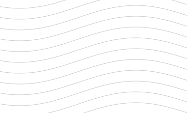

# Сценарный анализ и чувствительность

<br clear="all">

## Сценарии газосборной сети в tNavigator

На производственной практике я сравнивал расчётные корреляции многофазного потока: менял долю воды и следил за перепадами давления и температуры. Остальные исходные параметры фиксировал.


*Учебная модель из отчёта по практике.*

### Применённые навыки

| Навык аналитика | Как я его применил |
|---|---|
| Постановка сценарного анализа | Выделил изменяемый фактор, сравниваемые подходы и выходные показатели |
| Контроль условий сравнения | Менял долю воды при одинаковых остальных входных данных |
| Анализ чувствительности | Рассматривал реакцию давления и температуры на изменение параметра |
| Проверка смысла результата | Сопоставлял поведение модели с физическими допущениями корреляций |
| Подготовка структуры данных | Подготовил структуру таблицы запусков и пример обработки выгрузки |

### Моя работа

Работал с упрощённой сетью от куста скважин до установки подготовки газа, изменял параметры и расчётные корреляции в tNavigator. Сравнивал перепады давления и температуры; изучал области применимости расчётных подходов.

| Элемент сравнения | Что фиксировал |
|---|---|
| Входной фактор | Массовая доля воды |
| Вариант модели | Расчётная корреляция |
| Условия | Одинаковые остальные параметры |
| Метрики | Перепад давления и температуры |

### Пример обработки результатов

```python
pressure_drop = inlet_pressure - outlet_pressure
temperature_drop = inlet_temperature - outlet_temperature
sensitivity = (next_pressure_drop - pressure_drop) / (next_water_fraction - water_fraction)
```

- [scenario-comparison-template.csv](scenario-comparison-template.csv) — пустой шаблон для реальных запусков.
- [summarize_runs.py](summarize_runs.py) — пример кода: проверка столбцов и входных условий, расчёт перепадов и конечных разностей.
- [example-runs.csv](example-runs.csv) — **условные демонстрационные числа**, не результаты практики и не расчёт tNavigator.

```bash
python summarize_runs.py example-runs.csv --output example-comparison.csv
```

В учебном примере показываю, как рассчитываю перепады и сравниваю соседние сценарии. Чувствительность имеет единицы давления на единицу доли воды; в примере давление задано в МПа.

### Для каких аналитических задач это полезно

Сравнение сценариев, контроль одинаковых условий, подготовка таблиц параметров и поиск факторов, от которых зависит результат модели. При таком сравнении можно объяснить, почему варианты дают разные ответы.

### Связанные исследования

Отдельно я исследовал применимость методов машинного обучения к прогнозированию поведения газодобывающих скважин. В рамках ВКР моделировал выравнивание профиля приёмистости для поиска оптимальных решений закачки предварительно сшитых частиц геля. Эти задачи связаны с постановкой прогноза, выбором управляемых параметров и проверкой применимости модели к техническому объекту.

### Ограничения

Кейс описывает подход к сравнению сценариев в tNavigator. Числа в примере обработки условные: по ним нельзя выбирать лучшую корреляцию для реальной сети. Для такого выбора нужны результаты запусков при сопоставимых условиях.

---

[← Все проекты](https://github.com/antonyakovlev11)
