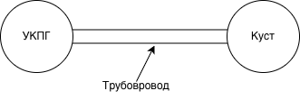

## Газосборная сеть в tNavigator

Я сравнивал, как разные расчётные корреляции описывают изменение давления и температуры при увеличении доли воды в потоке.

*Упрощённая модель из отчёта по производственной практике.*

### Контекст и задача
С 20 мая по 17 июня 2026 года я проходил производственную практику в ООО «РН-Геология Исследования Разработка» (РН-ГИР), группа «Роснефть». В tNavigator изучал расчёт многофазного потока на упрощённой сети от куста скважин до установки подготовки газа.

### Что я сделал
- Работал с учебной моделью в tNavigator: упрощал сеть и изменял параметры.
- Выбирал расчётные корреляции и менял массовую долю воды, сохраняя остальные исходные данные.
- Сравнивал перепады давления и температуры между кустом и установкой подготовки газа.
- Рассматривал области применения и физические допущения расчётных подходов.

### Логика сравнения
| Часть постановки | Что рассматривалось |
|---|---|
| Изменяемый параметр | Массовая доля воды в потоке |
| Сравниваемые подходы | Расчётные корреляции многофазного потока |
| Контроль условий | Остальные исходные параметры фиксировались |
| Выходные показатели | Перепады давления и температуры |
| Интерпретация | Чувствительность результата и физический смысл |

### Что я вынес из работы
На практике я учился сравнивать сценарии при одинаковых исходных условиях. Для меня было важно связать изменение параметра с реакцией модели и проверить, согласуется ли результат с физическим смыслом выбранной корреляции.

### Сохранённые материалы и следующий шаг
От практики у меня сохранились описание работы и изображение сети. Таблицы запусков и файл модели пока не восстановлены, поэтому я не привожу численный рейтинг корреляций и не называю одну из них лучшей.

[scenario-comparison-template.csv](scenario-comparison-template.csv) — пустой шаблон для будущей систематизации запусков: корреляция, доля воды, входное/выходное давление и температура. Я добавил этот шаблон к портфолио для будущих запусков; численных результатов в нём пока нет.

---

[← Все кейсы](https://github.com/antonislav11)
